## Group members

| Name | Student ID |
|---|---|
| CHEN XINGTONG | A0357556N |
| QIAN LONG | A0255547W |

Source code: <https://github.com/xtong629/dsa5208-cg-poisson> (the repository README explains how to build, run and reproduce every figure).

---

## 1 Introduction to the algorithm

### 1.1 The problem

We solve the Poisson equation with homogeneous Dirichlet boundary conditions on the unit square ($d=2$) and the unit cube ($d=3$),

$$-\Delta u = f \ \text{ in } \Omega=(0,1)^d, \qquad u = 0 \ \text{ on } \partial\Omega .$$

The Poisson equation is a standard model problem (electrostatics, steady heat conduction, the pressure
solve of incompressible flow). Both dimensions are implemented, with the same code templated on $d$.

### 1.2 Discretisation

We use a uniform grid with $N$ interior points per axis and spacing $h = 1/(N+1)$, so there are
$W = N^d$ unknowns (the problem size). The standard second-order finite-difference approximation of
$-\Delta$ gives, at interior point $i$,

$$(A u)_i = \frac{1}{h^2}\Big(2d\,u_i - \sum_{j \in \text{neighbours}(i)} u_j\Big),$$

with the 5-point stencil in 2D and the 7-point stencil in 3D; neighbours on the boundary contribute
$u=0$. $A$ is symmetric positive definite. The discrete problem is $A u_h = b$ with $b_i = f(x_i)$.
The discretisation error $u_h - u$ is $O(h^2)$.

**Matrix-free.** $A$ is never stored: a product $A p$ is computed by applying the stencil directly
to the array $p$. This needs $O(W)$ memory and, because the stencil only reads a handful of
neighbouring values, the product is memory-bandwidth bound rather than compute bound — which makes
communication and memory traffic, not arithmetic, the interesting part of the parallelisation.

### 1.3 Conjugate Gradient

CG (Hestenes & Stiefel, 1952) solves $A x = b$ for symmetric positive definite $A$ using only
products with $A$ and vector operations. We start from $x_0 = 0$, so $r_0 = b - A x_0 = b$, and
$p_0 = r_0$. Then, while $\|r_k\|$ is large:

$$\alpha_k = \frac{r_k^\top r_k}{p_k^\top A p_k},\quad
x_{k+1} = x_k + \alpha_k p_k,\quad
r_{k+1} = r_k - \alpha_k A p_k,\quad
\beta_k = \frac{r_{k+1}^\top r_{k+1}}{r_k^\top r_k},\quad
p_{k+1} = r_{k+1} + \beta_k p_k .$$

We stop when $\|r_k\|/\|b\| \le \text{tol}$. One iteration consists of **one product $A p_k$**,
**two dot products** ($p_k^\top A p_k$ and $r_{k+1}^\top r_{k+1}$) and three vector updates (two
"axpy" operations $y \leftarrow y + a x$ and one "xpay" $p \leftarrow r + \beta p$). The two dot
products are the only operations that need information from *all* parts of the vectors — this is
the origin of the global communication discussed in Section 2.

### 1.4 Why the iteration count grows with the grid size

The condition number of $A$ is $\kappa(A) = \lambda_{\max}/\lambda_{\min} \approx 4/(\pi^2 h^2) = O(h^{-2})$
(the smallest eigenvalue stays near $d\pi^2$, the largest grows like $4d/h^2$). CG's convergence
bound depends on $\sqrt{\kappa}$, so the number of iterations needed for a fixed tolerance grows
**linearly in $N$** (as $h^{-1}$). In the serial correctness runs at tolerance $10^{-10}$ we observe about $3.4\,N$
iterations in 2D and $4.3\,N$ in 3D. Consequences for the experiments:

* the time to *solution* grows like $N \cdot N^d$ (iterations × cost per iteration), faster than the problem size;
* when $N$ is increased with the number of ranks (weak scaling) the *number of iterations also grows*,
  so the time to solution is not constant even with perfect parallel efficiency.

For this reason, **all timing and scaling runs use a fixed number of iterations** (100) and we report time per
iteration; convergence to a tolerance is only used for validation and for the serial "time to solution" study.

### 1.5 Synthetic data and the manufactured solution

There are no input files; all data are generated analytically (which makes weak scaling easy: every rank
generates its own part of $f$ from the global grid indices). We use a *manufactured solution*

$$u(x) = \prod_{k=1}^{d} g(x_k),\qquad g(t) = t(1-t)e^{t},\qquad g''(t) = -t(3+t)e^{t},$$

which vanishes on the boundary, so $f = -\Delta u = -\sum_k g''(x_k)\prod_{l\ne k} g(x_l)$ is known in closed
form and the exact error $u_h - u$ is computable at every grid point. We report the discrete $L^2$ norm
$\sqrt{h^d \sum_i e_i^2}$ and the maximum norm.

A product of sines, $u = \prod \sin(\pi x_k)$, is the obvious first choice but is a **poor test problem**: the sampled
sine product is an exact eigenvector of the discrete operator $A$, so the Krylov space CG builds is
one-dimensional and CG converges in **one iteration**, making iteration counts and timings meaningless. (We
observed exactly this in our first implementation.) The function $g$ has broad spectral content, so CG needs
$O(N)$ iterations as it would for generic data.

---

## 2 Parallelization design decisions

*Terminology.* A **rank** is an MPI process. The grid is split into **subdomains**, one per rank. A **halo**
(or ghost layer) is a copy, stored on one rank, of the boundary values owned by a neighbouring rank. A **halo
exchange** updates these copies. $T_s$ is the runtime of the serial program and $T_p(n)$ the runtime on $n$
ranks (Lecture 7).

The algorithm is simple, so — in the words of Lecture 7 — the parallelisation has to be sophisticated. All of the
arithmetic (stencil, axpy, local part of the dot products) is perfectly parallel; the difficulty is entirely in
the two kinds of communication in each iteration:

* **(a) Halo exchange for $A p$.** Point-to-point messages with the neighbouring ranks. The message size is
  proportional to the *surface* of the subdomain while the computation is proportional to its *volume*, so this
  cost is bandwidth-bound and shrinks relative to computation as subdomains grow.
* **(b) Two global reductions** (`MPI_Allreduce` of one double each). A collective over all $n$ ranks; the message is tiny,
  so the cost is *latency*-bound, grows with $\log n$, and does not shrink when the subdomains shrink.

A simple model of one iteration on $n$ ranks, for problem size $W$, is
$t_\text{iter}(n) \approx c\,W/n + t_\text{halo} + 2\,t_\text{ar}(n)$, where $c$ is the per-unknown cost of the
local kernels, $t_\text{halo}$ the halo cost (set by surface, latency and bandwidth) and
$t_\text{ar}(n) \approx a + b\log_2 n$ the Allreduce time. In strong scaling ($W$ fixed) the first term shrinks
as $1/n$ while the other two do not, so efficiency must eventually fall; in weak scaling ($W/n$ fixed) only the
Allreduce term grows. We test these expectations in Section 4.

### 2.1 Data layout and domain decomposition

Each rank stores its box of $n_x \times n_y \,(\times n_z)$ interior points in a contiguous array with $x$ fastest,
surrounded by a one-cell ghost layer on every active side (`src/common/grid.hpp`). Ghost cells on the physical
boundary stay zero (the Dirichlet condition) and ghost cells on inter-rank boundaries receive neighbour data, so
the stencil kernel needs **no boundary special cases**. If $N$ is not divisible by the process grid, the first
$N \bmod p$ ranks along an axis get one extra row.

The process grid is created with `MPI_Dims_create` and `MPI_Cart_create`. We compare two decompositions:

* **Slab (1D):** all splits along the slowest axis. Every rank exchanges two full planes of $N^{d-1}$ points,
  **independent of $n$**; slabs cannot use more than $N$ ranks.
* **Block (2D in 2D, 3D in 3D):** a balanced process grid with $n^{1/d}$ ranks per axis. A rank has $2d$ faces
  of $\approx (N/n^{1/d})^{d-1}$ points: the halo volume per rank shrinks as $2d\,N^{d-1} n^{-(d-1)/d}$.

The surface-to-volume ratio (halo points per owned point) is $2n/N$ for slabs and $2d\,n^{1/d}/N$ for blocks, so blocks
communicate less at large $n$, at the price of more (smaller) messages per iteration ($2d$ instead of $2$).
`MPI_Dims_create` returns counts in non-increasing order; we reverse them so that the *slowest* axis receives the
largest count, which keeps the contiguous $x$ loops long.

### 2.2 Halo exchange: three variants

Because the stencil uses only face neighbours, no edge or corner data are needed: a rank exchanges at most $2d$
faces of one layer. Non-contiguous faces are described by MPI derived datatypes
(`MPI_Type_create_subarray`), so no manual packing is needed on the CPU.

1. **Blocking:** `MPI_Sendrecv`, axis by axis (2 phases per axis); the computation starts only after all exchanges are complete.
2. **Non-blocking:** `MPI_Irecv`/`MPI_Isend` for all faces at once, then `MPI_Waitall`, then the full stencil (no overlap).
3. **Non-blocking with overlap:** post the messages, apply the stencil to the **inner box** (points that do not touch
   a ghost cell) while the messages are in flight, call `MPI_Waitall`, then apply the stencil to the
   **boundary shell** (the remaining points, split into disjoint thin boxes).

*Caveat on overlap.* Posting a non-blocking operation does not guarantee that data move while the application
computes: many MPI implementations only progress large (rendezvous-protocol) messages inside MPI calls unless an
asynchronous progress thread or hardware offload is available. Overlap can therefore yield little or no benefit,
and we measure it (variant 3 against variant 2) instead of assuming it. In our timers the halo time is the time
spent inside MPI (posting plus waiting), i.e. the *exposed* communication; hidden communication appears as part of the stencil time.
(Periodically calling `MPI_Test` during the inner computation to drive progress is a possible refinement that we did not implement;
a one-sided variant with `MPI_Put`/`MPI_Win_fence` is also not implemented.)

### 2.3 Global reductions

Each dot product is a local sum followed by one `MPI_Allreduce` of a single `double`: two per iteration. Their cost is measured separately with a
micro-benchmark (`--bench-allreduce`) and inside the solver. Note that the time measured inside the solver includes **waiting for the slowest rank**
(load imbalance or noise), since a collective cannot finish before every rank has arrived. Because the order of
summation changes with the number of ranks, parallel and serial results differ at rounding level; we therefore
validate with tolerances and not with exact equality (Section 6).

### 2.4 Hybrid MPI+OpenMP

Each rank runs several OpenMP threads, so a fixed number of cores is covered by fewer ranks: smaller halo surfaces in total,
fewer participants in the Allreduce, but fork–join overhead and NUMA effects. Design:

* `MPI_Init_thread` with `MPI_THREAD_FUNNELED` (only the master thread calls MPI); the provided level is checked and recorded in the output.
* Stencil, axpy, xpay and the local dot products are `parallel for` loops over the two outer loops with **static** scheduling; dot products use
  `reduction(+:...)` followed by a single `MPI_Allreduce`.
* **Overlap:** the master thread posts `Isend`/`Irecv` outside any parallel region, all threads compute the inner box, the master calls `Waitall`, all threads compute the boundary shell
  (in a single parallel region to avoid repeated fork–join).
* **First-touch initialisation:** Linux places a memory page on the NUMA node of the thread that first writes it. Vectors are allocated uninitialised and zeroed by the same static
  loop distribution that the kernels use, so each thread's data stays on its own NUMA node.
* Threads are pinned (`OMP_PROC_BIND`, `OMP_PLACES`, and the launcher's binding options).

### 2.5 MPI+CUDA on GPUs

Since $X$ = OpenMP, the grading scheme also requires a GPU test; we implemented MPI+CUDA. One rank drives one GPU; the vectors live in GPU memory
in the same padded layout, and only scalars (dot products) go to the host.

* **Kernels:** one stencil kernel that works on a box of points (used for the inner box and for the thin shell boxes, so there is no boundary
  branch and no warp divergence from boundary handling); axpy/xpay kernels; a dot product as a two-pass tree reduction in a fixed order without atomics (deterministic); pack/unpack kernels that copy a face between the padded array and a contiguous message buffer.
* **Halo exchange:** the faces are packed into device buffers and sent with MPI. With **CUDA-aware MPI** the MPI calls receive device pointers, so data can move GPU-to-GPU without a copy through host memory where the hardware and library allow it;
  the alternative **host staging** copies the packed faces through pinned host buffers. Both paths are implemented and selectable at run time so that they can be compared.
* **Overlap:** packing and unpacking run on a high-priority stream; the inner-box kernel runs on another stream while the messages are in flight; the shell kernels run after the unpack.

### 2.6 Measurement methodology

* **Timers:** each run records the time in the stencil, the halo exchange, `MPI_Allreduce`, the vector updates, and "other" (the remainder). Section times are the mean over ranks and the total is the maximum over ranks.
* **Fixed iterations:** timing runs execute exactly 100 CG iterations; each point is repeated 3 times and the **median** is reported.
* **Definitions (Lecture 7).** Speedup $= T_s/T_p(n)$; parallel efficiency $= T_s/(n\,T_p(n))$, where $T_s$ is measured with the *serial program* on the same machine
  (MPI with one rank is shown only as an additional reference). **Amdahl's law:** speedup $= 1/(S + P/n)$ with serial fraction $S = 1-P$; we fit $S$ to the measured strong-scaling speedup. **Gustafson's law** for weak scaling:
  scaled speedup $= S + P\,n$.
  **Strong scaling:** fixed $N$, increasing $n$. **Weak scaling:** $N$ and $n$ increased together so that the number of points per rank is (approximately) constant; because $N(n)=\mathrm{round}(N_1 n^{1/d})$ is an integer, the efficiency is normalised by the exact points per rank
  (definition in `scripts/plot.py`).
* **Machine:** all experiments (CPU and GPU) were run on the NUS Vanda cluster, so that $T_s$ and $T_p(n)$ come from the same hardware. CPU jobs were restricted to the pure CPU nodes, so every CPU timing comes from the same model: **Intel Xeon Platinum 8452Y** (recorded in the provenance file of every run), 2 sockets × 36 cores, 512 GB per node. A job gets 64 of the 72 cores of a node (`ncpus=64`, exclusive node), so 64, 128 and 256 ranks fill 1, 2 and 4 nodes. PBS caps memory at 6 GB per requested core. MPI: HPC-X Open MPI 4.1.9a1 from the NVHPC 26.1 module (`nvc++`-backed `mpicxx`, `-O3 -std=c++17`); ranks are pinned with `taskset`. GPU: NVIDIA A40 (`sm_86`), CUDA 12.9, one rank per GPU, 36 CPU cores per GPU.
  The nodes are connected by **plain Ethernet** (TCP; the RDMA-capable ports of the NICs are down, so no InfiniBand/RoCE transport is available). A one-double `MPI_Allreduce` takes about **52 µs** on 2 nodes with 4 ranks each and about **175 µs** on 2 nodes with 64 ranks each (Section 4.3), against 6 µs for 64 ranks inside one node. The interconnect therefore matters for the strong-scaling runs with little work per rank (Section 4.3), but it is *not* the main reason for the efficiency loss in weak scaling, which happens inside the first node (Section 4.2).
* Timings from the development laptop are used only to check correctness and never appear in this report.

---

## 3 Serial scaling

**Figure 1** (left: time per CG iteration vs number of unknowns; right: time to reach tolerance vs number of unknowns; both axes logarithmic; 2D and 3D). Raw data: `results/vanda/serial.csv` (one CPU core of a pure CPU node, 3 repetitions, median).

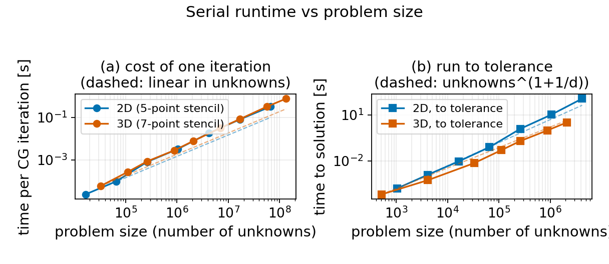{width=100%}

* **Time per iteration grows linearly with the number of unknowns once the arrays leave the caches.** At small sizes the cost per unknown is much lower: 1.5 ns per unknown for the 2D $N=256$ problem (65 k unknowns, cache-resident), against 4.7 ns for 2D $N=4096$ and 4.8 ns for $N=8192$ (17 M and 67 M unknowns). In 3D it rises from 3.3 ns ($N=64$) to 4.9 ns ($N=256$) and 5.6 ns ($N=512$). This 3–4× difference between cache-resident and memory-resident problems is the first sign that CG is limited by memory bandwidth; the same effect appears in the parallel runs (Section 4.1).
* **2D and 3D cost almost the same per unknown** (curves in panel (a) lie on top of each other). We expected a 3D iteration to be noticeably more expensive per unknown (7-point instead of 5-point stencil); the measurement shows only a 4–17% difference at 17 M to 134 M unknowns, because the vector updates and dot products, which are the same in both dimensions, dominate (Section 4.3: in the solver they take more than half of the time).
* **Time to solution** (panel (b)) grows like unknowns$^{1+1/d}$ (dashed guides) because the iteration count grows like $N$ (Section 1.4). The two panels together show why the parallel experiments use a fixed number of 100 iterations and report time per iteration.

The baselines $T_s$ for Sections 4 and 5 are the serial runs at the sizes in Table 1 (time for 100 iterations; the same numbers are in the data file `strong_scaling.csv` in the `tables` subfolder of `figures/`).

**Table 1.** Serial baselines $T_s$: time for 100 CG iterations on one core of a Vanda CPU node.

| problem | unknowns | $T_s$ (100 iterations) |
|---|---|---|
| 2D $N=4096$ | 16.8 M | 7.91 s |
| 2D $N=8192$ | 67.1 M | 31.98 s |
| 3D $N=256$ | 16.8 M | 8.20 s |
| 3D $N=512$ | 134 M | 74.94 s |

The serial binary needs more than 6 GB for 3D $N=512$, so the serial job is submitted with 2 cores (12 GB) to stay under the PBS memory cap per core; it still uses one thread (a first attempt with 1 core was killed by the memory limit and discarded).

---

---

## 4 MPI scaling and efficiency

**Setup.** Rank counts $n = 1, 2, 4, \dots, 256$ (powers of two; 64 ranks per node, so 128 and 256 ranks use 2 and 4 whole nodes; 512 ranks were not run). Each job has exclusive use of its nodes (`place=excl`), the code is pure MPI with one thread per rank, block decomposition, non-blocking halo exchange with overlap unless stated otherwise, fixed 100 CG iterations, 3 repetitions, median. Strong scaling: 2D $N=4096$ and $8192$ (16.8 M and 67.1 M unknowns), 3D $N=256$ and $512$ (16.8 M and 134 M unknowns); rank counts whose subdomain would exceed 17 M points are skipped to save core-hours, so the large problems start at 8 ranks. Weak scaling: constant points per rank, 2D $1024^2$ and $2048^2$, 3D $64^3$ and $128^3$ per rank, up to 256 ranks.

### 4.1 Strong scaling

**Figures 2 and 3** (runtime, speedup $T_s/T_p(n)$ and efficiency $T_s/(nT_p(n))$ vs $n$ on logarithmic axes) and **Table 2** (data file `strong_scaling.csv` in the `tables` subfolder of `figures/`).

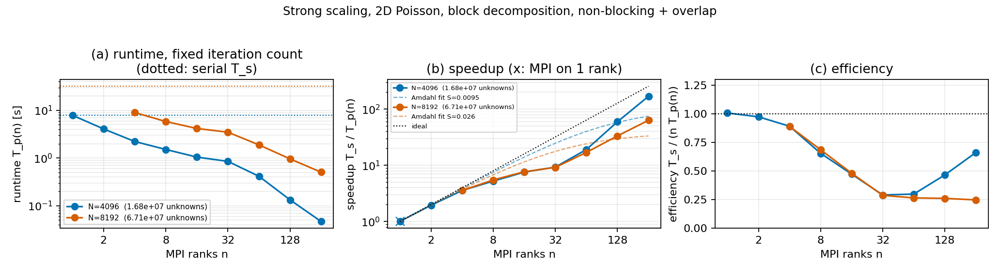{width=100%}

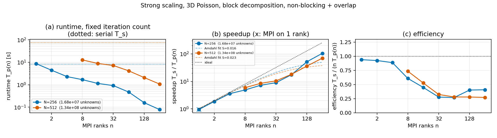{width=100%}

**Table 2.** Strong scaling: speedup $T_s/T_p(n)$ with parallel efficiency in brackets.

| problem | $n=8$ | $n=64$ | $n=128$ | $n=256$ |
|---|---|---|---|---|
| 2D $N=4096$ | 5.2× (0.65) | 19.1× (0.30) | 59.7× (0.47) | 169.5× (0.66) |
| 2D $N=8192$ | 5.5× (0.69) | 17.0× (0.27) | 33.4× (0.26) | 63.4× (0.25) |
| 3D $N=256$ | 4.9× (0.61) | 17.4× (0.27) | 51.7× (0.40) | 104.7× (0.41) |
| 3D $N=512$ | 5.9× (0.74) | 18.0× (0.28) | 35.9× (0.28) | 69.9× (0.27) |

* **Efficiency collapses inside the first node.** With 1 to 4 ranks it is 0.9–1.0 (one MPI rank is within 6% of the serial program), at 8 ranks 0.6–0.7, and at 32–64 ranks it is only about 0.27–0.30 for *all four* problems, whether the subdomains are large or small. This is the signature of a memory-bandwidth-bound kernel: CG does very little arithmetic per byte moved, so once a few cores saturate the memory controllers of the socket, additional ranks on the same node bring little. The speedup saturates at about 17–19 on one node of 64 cores for every problem. This explanation is consistent with the serial measurement (Section 3) and with the breakdown (Section 4.3, where vector updates and stencil sweeps, both memory-bound, take most of the time at 8 ranks), but **we did not measure the node's memory bandwidth directly** (no STREAM-type test), so it remains the most plausible explanation rather than a proven one. A confirmed contributing factor: a node has 2 sockets (= 2 NUMA nodes) of 36 cores each, and the 64 cores PBS gives to an exclusive job are *not* balanced between them — we printed the layout from inside such a job: NUMA node 0 gets all of its 36 cores and NUMA node 1 only 28 of 36. With the ranks pinned in this order, 36 ranks share the memory controllers of socket 0 and 28 those of socket 1, so the busier socket limits the speed of the whole job, and a balanced 32 + 32 placement would probably be somewhat faster. We did not measure that alternative. This affects all 64-rank-per-node results alike and therefore not the shape of the curves, but it lowers the absolute efficiency at 64, 128 and 256 ranks (all of which use fully loaded nodes).
* **Beyond one node, the small problems recover; the large ones do not.** For 2D $N=4096$ the efficiency rises again from 0.30 (64 ranks) to 0.66 (256 ranks; **this last point is uncertain**, see below), and for 3D $N=256$ from 0.27 to 0.41. Adding nodes adds memory bandwidth, and the subdomains become small enough to fit partly into the caches (the same effect that made small serial problems cheap per unknown). The large problems ($N=8192$ in 2D, $N=512$ in 3D) stay at about 0.25–0.28 from 64 ranks on, since their subdomains stay far larger than the caches.
* **Amdahl's law fits poorly and its serial fraction should not be read literally.** The least-squares fits give $S = 0.0095$ and $0.026$ (2D $N=4096$, $8192$) and $0.016$ and $0.023$ (3D $N=256$, $512$), i.e. a predicted speedup limit of 40–100. The measured curves do not have the shape of Amdahl's law: they flatten at about 17 on one node (bandwidth saturation) and then *increase again* across nodes, so a single constant $S$ cannot describe them. $S$ lumps together true serial work (very little here; the code has no serial section apart from setup), communication, synchronisation and bandwidth saturation. We therefore report the fits as a summary of the data and do **not** claim that 1–3% of the program is inherently serial.
* **Communication matters at 128–256 ranks for the smaller problems** (Section 4.3): the Allreduces take about 40% (128 ranks) and 60% (256 ranks) of an iteration for 3D $N=256$, and only 9–16% for 3D $N=512$.
* **Noise:** the iteration time at 256 ranks is below 1 ms for the small problems, so single repetitions vary by up to 30–40% (for example 2D $N=4096$ at 128 ranks and 3D $N=256$ at 256 ranks); the table uses the median of three. **The 2D $N=4096$ point at 256 ranks is the clearest case:** the strong-scaling run gives about 0.47 ms per iteration (speedup 169.5, efficiency 0.66), but the separate pure-MPI 256×1 measurement of Section 5.1 (Table 5) gives 0.75 ms for the same configuration, which would be an efficiency of about 0.41 ($T_s$ = 79.1 ms per iteration); the hybrid binary's 256×1 run (0.46 ms) agrees with the strong-scaling value. We could not tell which is closer to the typical value, so for this point we quote both and do not change the data. The conclusion that the efficiency rises again beyond one node holds in either case (0.41 or 0.66 against 0.30 at 64 ranks).

### 4.2 Weak scaling

**Figures 4 and 5** (time per iteration and weak-scaling efficiency vs $n$) and **Table 3** (weak-scaling efficiency; data file `weak_scaling.csv` in the `tables` subfolder of `figures/` also has the measured scaled speedup), up to 256 ranks (4 nodes).

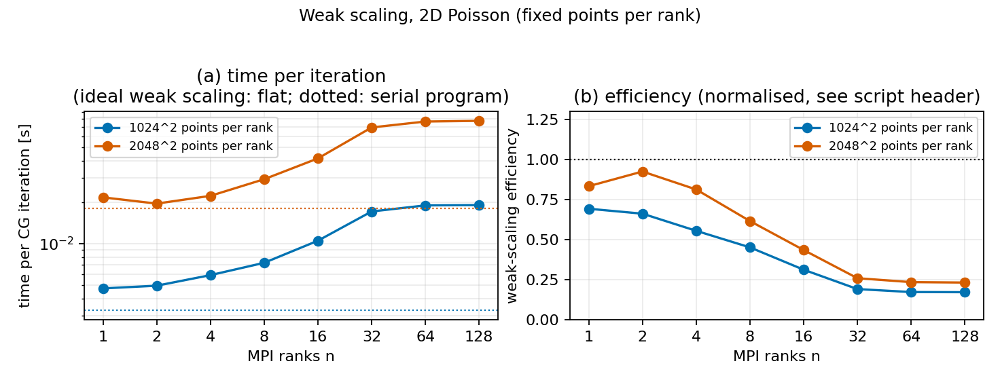{width=100%}

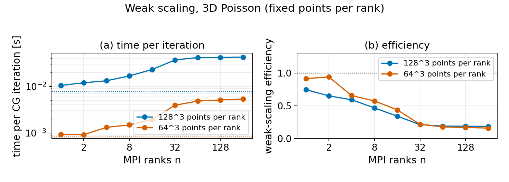{width=100%}

**Table 3.** Weak-scaling efficiency by number of ranks $n$ (scaled speedup at 256 ranks: 41–60, against 256 for ideal Gustafson scaling).

| points per rank | $n=1$ | $n=8$ | $n=64$ | $n=128$ | $n=256$ |
|---|---|---|---|---|---|
| 2D $1024^2$ | 0.69 | 0.45 | 0.17 | 0.17 | 0.17 |
| 2D $2048^2$ | 0.83 | 0.62 | 0.24 | 0.23 | 0.23 |
| 3D $64^3$ | 0.91 | 0.57 | 0.18 | 0.17 | 0.16 |
| 3D $128^3$ | 0.74 | 0.47 | 0.19 | 0.19 | 0.18 |

* **The time per iteration rises by a factor of 3.5–5.2 between 1 and 64 ranks, then stays almost flat from 64 to 128 to 256 ranks** (for example 3D $128^3$ per rank: 41.5 ms at 64, 41.7 ms at 128 and 42.3 ms at 256; 2D $1024^2$: 18.9, 19.0 and 19.4 ms). Going from one node to two or four nodes therefore costs at most 2–5% here (7% for the smallest problem, 3D $64^3$: 4.85, 5.12, 5.38 ms), whereas going from 1 to 64 ranks inside one node costs a factor of 3.5–5. This is again the memory-bandwidth limit of Section 4.1: with weak scaling each rank brings its own data, the total memory traffic grows with $n$, but a node's memory bandwidth does not. The Allreduce (which grows with $n$) is only 8–9% of the iteration for $128^3$ per rank at 64 and 128 ranks (12% at 256) and 9–13% for the 2D problems, while for the small $64^3$ problem it grows from 18% (64 ranks) to 21% (128) and 27% (256): the latency of the Allreduce across nodes becomes visible only when the work per rank is small. It is not the main term for the larger problems.
* **The efficiency at $n=1$ is below 1** (0.69–0.91) because weak-scaling efficiency is normalised by the serial program's time at the base size, and the 1-rank MPI code is slower than the serial program at these sizes (by up to 44% for 2D $1024^2$; by 0–6% for the large strong-scaling problems). If the 1-rank MPI time were used as the baseline instead, all values would be higher by the same factor (for example 0.17/0.69 = 0.25 for 2D $1024^2$ at 256 ranks); we kept the serial program as baseline to be consistent with the definition of $T_s$ in Section 2.
* **Gustafson's law:** the scaled speedups of 41–60 at 256 ranks correspond to a "serial fraction" of about 0.77–0.84, far from the 1–3% suggested by the Amdahl fits. This inconsistency is another sign that neither law's assumption (a fixed serial fraction) holds for a bandwidth-bound code, and that the bandwidth limit, not serial code, is what bounds the scaling.
* As in Section 1.4, a real run needs more iterations as $N$ grows, so these figures compare time per iteration, not time to solution.

### 4.3 Impact of communication

**Figures 6 and 7** (time per iteration by section), **Figure 8** (Allreduce latency), **Figures 9 and 10** (slab vs block) and **Figures 11 and 12** (halo-exchange variants).

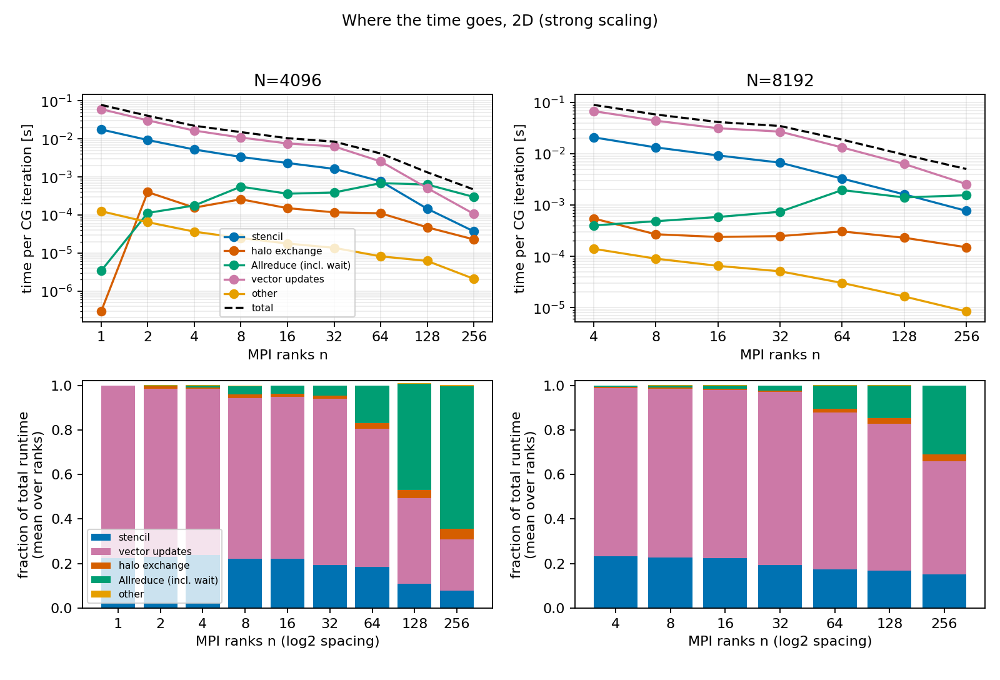{width=100%}

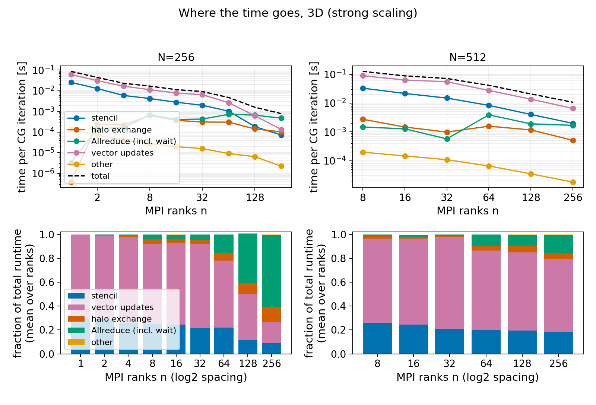{width=100%}

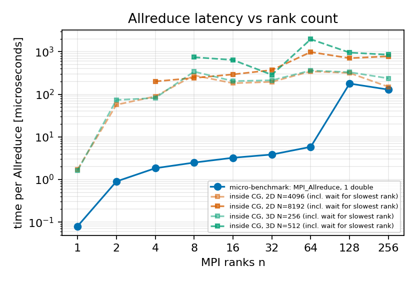{width=100%}

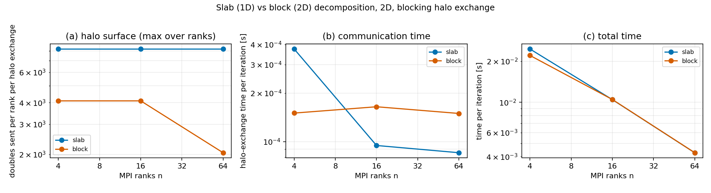{width=100%}

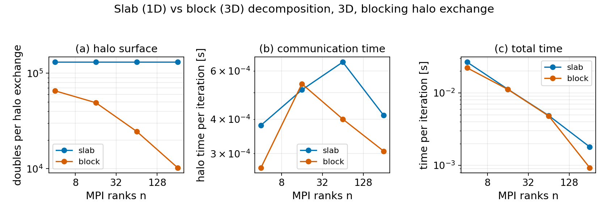{width=100%}

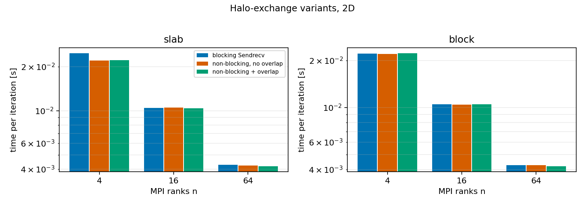{width=100%}

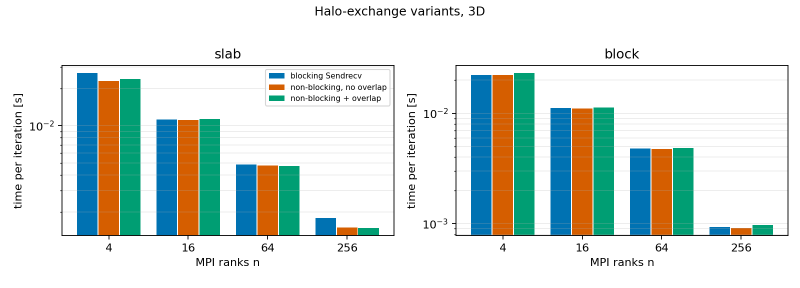{width=100%}

* **Where the time goes (3D $N=256$).** Share of an iteration spent in (stencil / halo / Allreduce / vector updates): 8 ranks 25% / 4% / 4% / 67%; 64 ranks 22% / 6% / 15% / 56%; 128 ranks 12% / 9% / 42% / 39%; 256 ranks 9% / 13% / 60% / 17%. For 2D $N=4096$ the picture is the same (Allreduce 17% at 64 ranks, 48% at 128, 64% at 256). For the large problem (3D $N=512$) the Allreduce is only 9% at 64 ranks and 16% at 256 ranks. So **for the smaller problems the Allreduce becomes the dominant cost at 128–256 ranks, more than the halo exchange** (13% at 256 ranks for 3D $N=256$): the halo volume shrinks with the subdomain surface, while the Allreduce time does not depend on the subdomain size and grows with the rank count and, across nodes, with the Ethernet latency.
* **Allreduce latency** (Figure 8). The micro-benchmark for one double grows slowly inside a node (0.08 µs for 1 rank, 2.5 µs for 8, 5.8 µs for 64) and jumps to about 130–180 µs once ranks sit on several nodes (128 and 256 ranks), a consequence of TCP over Ethernet (52 µs for 2 nodes with only 4 ranks each). **The time spent in the Allreduce inside the solver is much larger than the micro-benchmark** (0.2–2 ms per call, plotted as "incl. wait for slowest rank"), because the timer around the call also counts the time a rank waits for the slowest rank to arrive (load imbalance and memory-bandwidth variation between ranks). We did not separate waiting from transfer, so the "Allreduce" share in the breakdown overstates the pure network cost, particularly at 64 ranks inside one node, where the micro-benchmark is only 6 µs. The conclusion that the Allreduce is the dominant term at 256 ranks is therefore only qualitatively supported; a version with a barrier before the Allreduce would separate the two.
* **Slab vs block** (`decomp_halo`: 2D $N=4096$ and 3D $N=256$, 4/16/64 ranks on one node and 256 ranks on four nodes). *One node* (4–64 ranks): within about 1–2% of each other at 16 and 64 ranks; at 4 ranks the slab decomposition is clearly slower with blocking halo exchange (2D: 24.6 vs 22.1 ms; 3D: 26.7 vs 22.2 ms, i.e. 11–20%) and about 3–4% slower in 3D with the non-blocking variants. Inside a node the halo exchange is a memory copy and a small share of the iteration (2–6% at 8–64 ranks), so the decomposition barely matters. *Four nodes (256 ranks)*: in **3D the block decomposition is much faster**: 0.92–0.97 ms per iteration against 1.5–1.8 ms for slab (1.6–1.9× slower; the repetitions of the two do not overlap, ranges 0.73–1.15 ms vs 1.41–1.81 ms). The reason is the halo volume (`halo_doubles` per rank and exchange): 10 240 doubles for the block decomposition against 131 072 for slabs (12.8× more, in line with the surface formulas of Section 2.1: a slab of an $N^3$ grid has two full $N^2$ planes as halo), and the halo is now sent over the Ethernet; the halo timer takes 23–26% of the slab iteration and 12–33% of the block iteration. In **2D** the slab halo is also 8× larger (8 192 vs 1 024 doubles) but the two decompositions cannot be told apart: 0.62–0.77 ms (slab) and 0.71–0.80 ms (block) per iteration, with repetitions that differ by 1.3–2.3× from each other, because an iteration takes less than 1 ms at 256 ranks. We therefore claim an advantage of block over slab only for 3D at 256 ranks.
* **Blocking vs non-blocking vs overlap.** On one node (16 and 64 ranks) the three variants are within about 1–2% of each other, with no measurable gain from overlap; at 4 ranks overlap was even 1–4% slower for some cases. At 256 ranks non-blocking exchange was faster than blocking for the 3D slab (1.50 vs 1.80 ms, whose halo volume is large) but not for the 3D block decomposition (0.92 vs 0.93 ms), and **overlap gave no consistent gain** (3D block: 0.97 ms with vs 0.92 ms without overlap; 3D slab: 1.49 vs 1.50 ms; 2D differences of 4–19% in either direction, inside the repetition noise). Open MPI may not progress non-blocking transfers while a rank computes (Section 2.2), so the overlap can only help if the transfer is progressed by the library in the background; we did not test this (for example with `MPI_Test` calls inside the interior computation), so the result says that *our* overlap did not help on this MPI library, not that overlap cannot help.

---

## 5 MPI+X: OpenMP and GPU

### 5.1 MPI+OpenMP

**Figures 13 and 14** (2D and 3D). In Table 4 all configurations use 64 cores of one node ($n_\text{ranks}\times n_\text{threads}=64$).

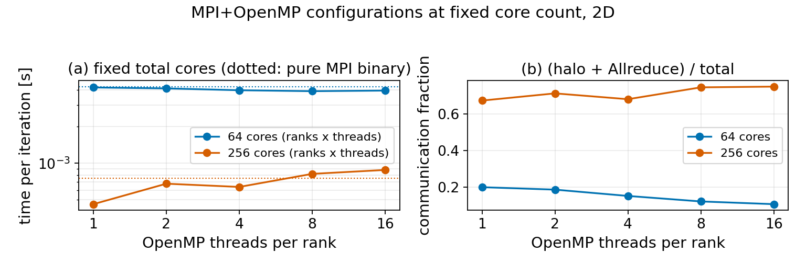{width=100%}

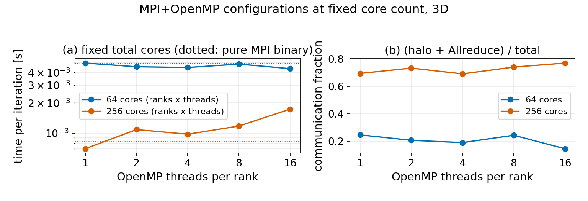{width=100%}

**Table 4.** MPI+OpenMP on one node (64 cores): median time per iteration in ms; column headings are ranks × threads.

| | MPI 64×1 | 32×2 | 16×4 | 8×8 | 4×16 |
|---|---|---|---|---|---|
| 2D $N=4096$ | 4.27 | 4.13 | 3.99 | **3.92** | 3.96 |
| 3D $N=256$ | 4.88 | 4.55 | 4.48 | 4.84 | **4.36** |

(the 64×1 hybrid binary measures 4.21 ms (2D) and 4.95 ms (3D); it matches the pure-MPI binary within 2%.)

* **Hybrid is 1–11% faster than pure MPI on one node (8–11% for the best configurations).** The best configurations are 8×8 for 2D (8% faster) and 4×16 for 3D (11% faster); the smallest gain in Table 4 is 3D 8×8 (4.84 vs 4.88 ms, about 1%). Fewer ranks mean fewer and larger messages, fewer participants in the Allreduce, and less halo surface; against this, threads add fork–join overhead and possible NUMA effects. On one node the gains are modest because the memory bandwidth limit (Section 4.1) bounds all configurations alike, and because all ranks pin their threads to neighbouring cores with `taskset` (we did not measure unpinned runs, nor the effect of first-touch separately).
* The differences between neighbouring configurations (for example 3D 8×8 vs 16×4) are of the same size as run-to-run noise, so the ranking of the middle configurations should not be over-interpreted; the clear result is that pure MPI (many ranks, one thread each) is the slowest or close to the slowest configuration.

**256 cores (4 nodes).** The same comparison on four whole nodes ($n_\text{ranks}\times n_\text{threads}=256$; 64 cores per node; ranks placed with `--map-by ppr:<ranks per node>:node`), 3 repetitions. Table 5 lists the median time per iteration in ms and, in brackets, the smallest and largest of the three repetitions. The 256×1 configuration was run by both binaries, which gives two reference values.

**Table 5.** MPI+OpenMP on four nodes (256 cores): median time per iteration in ms (minimum–maximum of 3 repetitions); column headings are ranks × threads.

| | pure-MPI binary 256×1 | hybrid binary 256×1 | 128×2 | 64×4 | 32×8 | 16×16 |
|---|---|---|---|---|---|---|
| 2D $N=4096$ | 0.75 (0.67–0.96) | 0.46 (0.44–0.49) | 0.68 (0.67–0.69) | 0.64 (0.61–0.67) | 0.82 (0.54–1.08) | 0.88 (0.75–0.91) |
| 3D $N=256$ | 0.83 (0.67–0.93) | 0.70 (0.67–0.96) | 1.09 (0.89–1.10) | 0.98 (0.97–1.00) | 1.18 (1.03–1.44) | 1.74 (1.67–1.78) |

* **The 256×1 reference is itself uncertain.** The same configuration (256 ranks, one thread) takes 0.75 ms with the pure-MPI binary and 0.46 ms with the hybrid binary in 2D, with non-overlapping repetition ranges (0.67–0.96 vs 0.44–0.49 ms), and 0.83 vs 0.70 ms in 3D (overlapping ranges). The two binaries run the same algorithm; we did not find the reason for the 2D gap (it may come from the state of the nodes during the two runs, which are separate measurements within the same job), so we do not know which value is the better reference.
* **At 256 cores iterations are below 1.1 ms and repetition noise is large, so no configuration with 2–4 threads per rank is clearly better or worse than pure MPI.** In 2D, 128×2 and 64×4 (0.68 and 0.64 ms) lie between the two references (0.46 and 0.75 ms). In 3D, 128×2 and 64×4 (1.09 and 0.98 ms) are above both references' medians, but the 128×2 repetitions (0.89–1.10 ms) overlap the pure-MPI ones. Only the configurations with 8 and 16 threads per rank are clearly slower, especially in 3D (16×16: 1.67–1.78 ms against at most 0.96 ms for the references); in 2D 32×8 and 16×16 are slower than the hybrid-binary reference but overlap with the pure-MPI binary's range. In short: **at 256 cores hybrid brings no gain, and many threads per rank hurt.**
* This is the opposite of our expectation that fewer ranks would make the multi-node Allreduce cheaper. A likely reason (not measured): at about 0.5–1 ms per iteration each rank has little work, so the OpenMP fork–join and barrier overhead of every parallel loop (several per iteration), and the loss of the interior/boundary overlap inside the threaded region, are no longer small against the iteration time, while the Allreduce share does not fall enough to compensate. With one node the work per iteration is 4–5 ms and the threading overhead is hidden, which is why hybrid wins there.
* **Conclusion on hybrid:** it helps by 1–11% (8–11% for the best configurations) when the iteration is long (one node, 4–5 ms); at 256 cores (below 1.1 ms per iteration) it brings no measurable gain with 2–4 threads and hurts with 8–16 threads. We did not try other thread placements or a threaded Allreduce.
* **A placement error that we found and fixed.** The first 256-core hybrid run gave 190–260 ms per iteration, several hundred times slower than the pure-MPI run. Cause: with plain by-slot mapping Open MPI fills nodes one after another, so with fewer ranks than slots all ranks and their threads were packed onto too few nodes (a diagnostic job printed the ranks per node: for 64 ranks × 2 threads on two nodes, all 64 ranks were on one node; with `--map-by ppr:32:node` they are 32 + 32). The affected rows were discarded and re-run with `ppr` mapping (`scripts/map_diag.sh` reproduces the check). The one-node results above were not affected (one node, nothing to spread).

### 5.2 MPI+CUDA (GPU)

**Figure 15**: one A40 GPU against 36 CPU cores (the CPU part of the same GPU node, Xeon Platinum 8452Y), time per iteration, 2D and 3D, for increasing problem size.

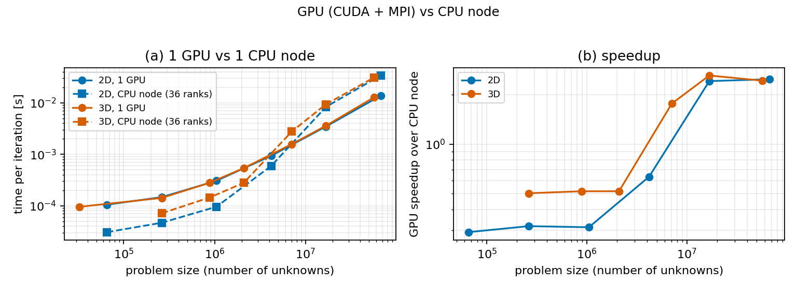{width=100%}

* **The GPU only wins for large problems.** Below roughly 2–7 million unknowns the CPU is faster (GPU speedup 0.3–0.7: for example 3D $N=128$: 0.54 ms on the GPU vs 0.28 ms on 36 CPU cores; 2D $N=1024$: 0.31 vs 0.10 ms). The GPU time per iteration is almost flat (0.1–0.3 ms) for small problems, which is the cost of kernel launches and host synchronisation (every dot product ends with a device-to-host copy). The crossover lies between $N=2048$ and $4096$ in 2D (0.94 vs 0.59 ms at $N=2048$; 3.5 vs 8.3 ms at $N=4096$) and between $N=128$ and $192$ in 3D (0.54 vs 0.28 ms; 1.6 vs 2.8 ms).
* **At large sizes the GPU is about 2.4× faster than the 36 cores:** 3D $N=384$ (56.6 M unknowns): 12.8 vs 31.0 ms per iteration; 2D $N=8192$: 13.7 vs 34.0 ms. Both are expected to be memory-bandwidth-bound, but we did not measure the bandwidths. We compare against 36 of the 72 cores because the GPU job gets 36 CPUs per GPU; against a whole CPU node (64 cores) the CPUs would probably look better, and the single-core serial times of Section 3 are not the right comparison either.
* **Correctness:** the GPU self-test (`build/cuda --selftest`) passed on Vanda: 48/48 checks with 1 and 2 ranks, for both CUDA-aware device halos and host-staged halos, matching the CPU results to about $10^{-16}$ with identical iteration counts (first-login job, 14 Nov 2026). In the timing runs, the GPU and CPU runs agree on the $L^2$ error to 6 digits.

**Figures 16 and 17: one and two GPUs of one node** (2D $N=8192$ and 3D $N=384$; one rank per GPU, 3 repetitions, median).

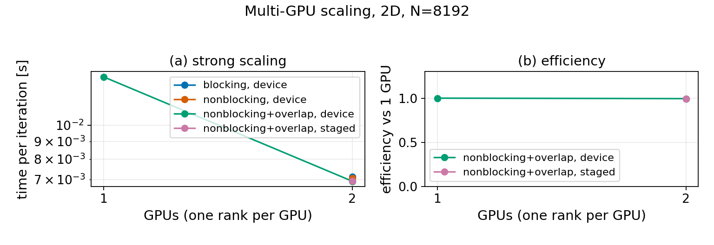{width=100%}

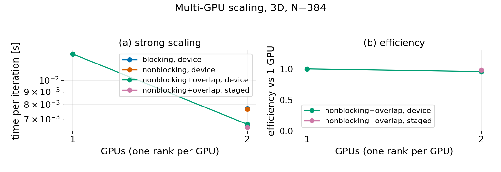{width=100%}

**Table 6.** One and two GPUs: median time per iteration in ms.

| | 1 GPU | 2 GPUs, blocking | 2 GPUs, non-blocking | 2 GPUs, non-blocking + overlap | 2 GPUs, overlap, host-staged halos |
|---|---|---|---|---|---|
| 2D $N=8192$ | 13.76 | 7.12 | 7.07 | **6.92** | 6.92 |
| 3D $N=384$ | 12.77 | 7.72 | 7.66 | 6.67 | **6.49** |

* **Two GPUs give a speedup of 1.99× (2D) and 1.91–1.97× (3D), i.e. an efficiency of 0.96–0.99** (3D: 0.96 with device halos, 0.98 with staged halos, with overlap). The GPU work per iteration is large (13 ms) compared with the halo exchange and the Allreduce, which are small and nearly independent of the number of GPUs.
* **Overlap helps in 3D, hardly in 2D.** Non-blocking exchange with overlap is 13% faster than non-blocking without overlap in 3D (6.67 vs 7.66 ms; the 3D halo is a whole plane of $384^2$ points) and 2% faster in 2D (the 2D halo is a single line). Blocking vs non-blocking without overlap differs by under 1%.
* **CUDA-aware MPI did not beat host staging here.** With the device-pointer halo (CUDA-aware) and with staging through host memory the times are equal in 2D (6.92 ms both) and staging is 3% *faster* in 3D (6.49 vs 6.67 ms). We did not investigate why (it may depend on how HPC-X moves device memory between the two GPUs of this node); the practical conclusion for this machine is that the staged path is not slower, and we cannot claim a benefit from CUDA-aware MPI.
* **Correctness of the cross-GPU path:** the 2-rank self-test inside this job, run with both A40s visible (rank $r$ uses GPU $r \bmod 2$, so the two ranks are on different GPUs), passed 48 of 48 checks for device and staged halos, with differences of at most $8\times10^{-16}$ from the CPU solution and identical iteration counts.
* **Limits:** only two GPU counts (one node has 2 GPUs) and one problem size per dimension, so this is not a scaling curve; and the Allreduce between GPUs of different *nodes* (Ethernet) was not tested. We did not measure the Allreduce share of the GPU iteration separately.

---

## 6 Validation

We validate with a small number of well-chosen test categories (implemented in `scripts/validate.py`; the GPU version is `build/cuda --selftest`). The results below come from the **full validation grid run as a batch job on a Vanda CPU compute node** (HPC-X Open MPI 4.1.9a1 from the NVHPC 26.1 module) and from the GPU self-test on an NVIDIA A40 node; no local numbers are used. The grid covers 1, 2, 4, 6 and 8 ranks, 1–4 OpenMP threads per rank for the hybrid code, 2D sizes up to $N=255$ and 3D sizes up to $N=63$. Every check passed.

1. **Convergence of the discretisation error.** The error against the exact manufactured solution decreases as $O(h^2)$: the observed order $\log(e_{N_1}/e_{N_2})/\log(h_1/h_2)$ between consecutive grids is between $1.997$ and $2.000$ in the $L^2$ norm (2D $N=15\to31\to63\to127\to255$, 3D $N=7\to15\to31\to63$) and between $1.98$ and $2.00$ in the maximum norm, for the serial, MPI and hybrid programs. In the same runs CG has converged and the true residual $\|b-Ax\|/\|b\|$, recomputed explicitly from the final solution, is below $1.6\times10^{-11}$, which checks that the CG recurrence has not drifted from the true residual.
2. **Parallel equals serial, and the check can fail.** The relative difference $\|x_\text{par}-x_\text{ser}\|/\|x_\text{ser}\|$ between the distributed solution and the serial one is at rounding level — at most $1.2\times10^{-15}$ for the MPI program and $1.6\times10^{-15}$ for the hybrid program (all rank and thread counts above; tolerance used in the test: $10^{-9}$). The iteration count equals the serial count in every run (the test would allow $\pm2$, because the summation order differs). **Negative control:** to confirm that the comparison can fail, a deliberately loosely converged parallel solution (tolerance $10^{-4}$, 4 ranks) is compared with the tightly converged serial solution; the test reports differences of $3.0\times10^{-6}$ (2D $N=63$) and $8.7\times10^{-6}$ (3D $N=15$), i.e. it rejects them, as it should (the iteration counts differ too: 128 vs 247 and 33 vs 77).
3. **Decomposition and halo-variant equivalence.** Slab and block decompositions, and blocking, non-blocking and overlapped halo exchange, give the same iteration count and the same error norm in every case (2D $N=127$, 3D $N=31$), for the MPI and for the hybrid program.
4. **Awkward sizes.** $N$ not divisible by the process grid (2D $N=50$ on 6 ranks, 3D $N=29$ on 8 ranks) and subdomains thinner than three points, so that the inner box is empty and the boundary shell covers everything (2D $N=4$ and $10$, 3D $N=4$, $5$ and $7$ on 4–8 ranks; both decompositions, with and without overlap): differences from serial below $7.1\times10^{-16}$ and identical iteration counts, for the MPI and the hybrid program.
5. **GPU self-test on an A40.** `build/cuda --selftest` passed 48 of 48 checks with 1 rank and with 2 ranks, for slab and block decompositions, blocking / non-blocking / overlapped halos, and both CUDA-aware device halos and host-staged halos, against the CPU solution: differences between $1.9\times10^{-16}$ and $7.9\times10^{-16}$ and identical iteration counts (for example 247 for 2D $N=63$, 159 for 3D $N=31$). It was run twice (first-login job and the start of the `gpu_multi` job); in the second the two ranks ran on the two different GPUs of the node, which exercises the cross-GPU halo exchange.

The validation was run on 14–15 November 2026 (job output is not stored in the repository). The negative control was added to `validate.py` as test 6 after the full grid had already run, and was run separately on the same node type (`python3 scripts/validate.py negative`); `python3 scripts/validate.py all` now includes it.

---

## 7 Discussion

**Terms.** Rank, subdomain, halo, halo exchange, Allreduce, slab and block decomposition, speedup and efficiency are defined in Section 2. Two further terms: *memory-bandwidth-bound* means limited by the speed at which data move between main memory and the cores, not by arithmetic; *weak/strong scaling* are as in Section 2.6. All times are per CG iteration (fixed 100 iterations), measured on Vanda only.

**How the problem was split.** The $N^d$ grid is divided into a Cartesian grid of boxes, one per MPI rank (Section 2.1); the matrix is never stored, each rank holds its own part of the vectors plus a one-point ghost layer. Per iteration a rank exchanges its halo with up to $2d$ neighbours and takes part in two Allreduces. The data volume sent is proportional to the subdomain surface: for 3D $N=256$ on 256 ranks it is 10 240 doubles per rank for blocks but 131 072 for slabs (12.8× more).

**Which parts need the most communication.** Inside a node (8–64 ranks) communication is small: the halo takes 2–6% of an iteration and the Allreduce 4–15% (3D $N=256$), and most time goes to vector updates and stencil sweeps. Across nodes the picture changes for the small problems: at 256 ranks the Allreduce takes 60% of an iteration for 3D $N=256$ and 64% for 2D $N=4096$ (the halo 13% for 3D), against 16% for 3D $N=512$. The Allreduce time does not shrink with the subdomain, while the halo does. This share includes the time ranks wait for the slowest rank (Section 4.3), so it overstates the network cost; the micro-benchmark gives 5.8 µs for 64 ranks in a node and 130–180 µs once several nodes are involved. In short: the Allreduce, not the halo, limits scaling for small problems on many nodes; the halo matters only with a poor decomposition (slabs in 3D).

**Why efficiency drops inside a node.** With 1–4 ranks the efficiency is 0.9–1.0, at 32–64 ranks only 0.27–0.30 for all four problems, and the speedup saturates at 17–19 per node. Weak scaling shows the same: the time per iteration rises 3.5–5.2× from 1 to 64 ranks but then stays flat across 2 and 4 nodes (at most 2–5% more for the large problems). Because the loss happens inside the node and does not depend on the problem size, the most plausible cause is the shared memory bandwidth; this is consistent with the data but we did not measure the bandwidth, and a 36 + 28 core split between the two sockets of an exclusive 64-core allocation adds to it. The Amdahl fit (serial fraction 0.0095–0.026) does not describe the curves, so we do not interpret it as a serial fraction.

**What multi-node and GPU runs show.** Adding nodes adds memory bandwidth: efficiency rises again between 64 and 256 ranks, from 0.30 to 0.41–0.66 (2D $N=4096$; the 256-rank point is uncertain, Section 4.1) and from 0.27 to 0.41 (3D $N=256$), while the two large problems stay at 0.25–0.28. One A40 GPU is about 2.4× faster than the 36 CPU cores of its node for the largest problems (3D $N=384$: 12.8 vs 31.0 ms) but slower below about 2–7 M unknowns, where kernel launches and the host copy at every dot product dominate. Two GPUs of a node reach a speedup of 1.91–1.99× (efficiency 0.96–0.99); overlap gives 13% in 3D and 2% in 2D, and CUDA-aware MPI was not faster than host staging.

**Slab vs block, overlap, hybrid.** Block beats slab only where the halo is large and crosses the network: 3D at 256 ranks, 0.92–0.97 vs 1.5–1.8 ms; on one node and in 2D the difference is within noise or 1–2%, except at 4 ranks with blocking exchange (11–20% for slab). Overlap of halo exchange with the interior stencil gave no consistent gain on CPUs, probably because Open MPI does not progress the transfer while the rank computes (not tested directly). Hybrid MPI+OpenMP is 1–11% faster than pure MPI on one node (8–11% for the best configurations) and not better at 256 cores (iterations about 1 ms or shorter, repetition noise large): 2–4 threads per rank are not clearly better or worse than pure MPI, and 8–16 threads are clearly slower, especially in 3D (Section 5.1).

**Limitations.** (i) Timings come from shared cluster nodes and network; we use 3 repetitions and medians, but iterations below 1 ms (256 ranks) vary by up to 1.3–2.3× between repetitions, so small differences there are not conclusive. (ii) We time a fixed 100 iterations; a real solve needs more iterations as $N$ grows (Section 1.4), so the figures compare time per iteration, not time to solution. (iii) The memory-bandwidth explanation and the cache explanation of the multi-node recovery were not tested directly (no STREAM benchmark, no hardware counters). (iv) Weak-scaling sizes are rounded to integer $N$. (v) 512 ranks and multi-node GPU runs were not done; only two GPU counts. (vi) The Allreduce share includes waiting for the slowest rank.

**Not done.** One-sided (RMA) halo exchange; a communication-reducing CG variant with one Allreduce per iteration instead of two; Kokkos; a preconditioner (a multigrid preconditioner would make the iteration count independent of $N$, but is a different algorithm).

---

## 8 AI usage

We used Claude and Claude Code (Anthropic) to help plan the parallel design, write and debug the C++/MPI/OpenMP/CUDA code and the PBS job scripts, analyse the results, and draft this report. We reviewed and decided on the algorithm, design choices and experiments at each stage, ran and monitored the jobs on Vanda, checked the results against the validation tests, and edited the final report ourselves.

---

## References

1. M. R. Hestenes and E. Stiefel, "Methods of conjugate gradients for solving linear systems", *Journal of Research of the National Bureau of Standards* 49(6), 409–436, 1952.
2. Y. Saad, *Iterative Methods for Sparse Linear Systems*, 2nd ed., SIAM, 2003.
3. G. M. Amdahl, "Validity of the single processor approach to achieving large scale computing capabilities", *AFIPS Spring Joint Computer Conference*, 483–485, 1967.
4. J. L. Gustafson, "Reevaluating Amdahl's law", *Communications of the ACM* 31(5), 532–533, 1988.
5. Message Passing Interface Forum, *MPI: A Message-Passing Interface Standard, Version 4.0*, 2021.
6. OpenMP Architecture Review Board, *OpenMP Application Programming Interface*.
7. NVIDIA, *CUDA C++ Programming Guide*.
8. DSA5208 lecture notes, Lectures 7, 8, 9 (OpenMP), 10 (CUDA) and 12 (A. Chen), National University of Singapore.
